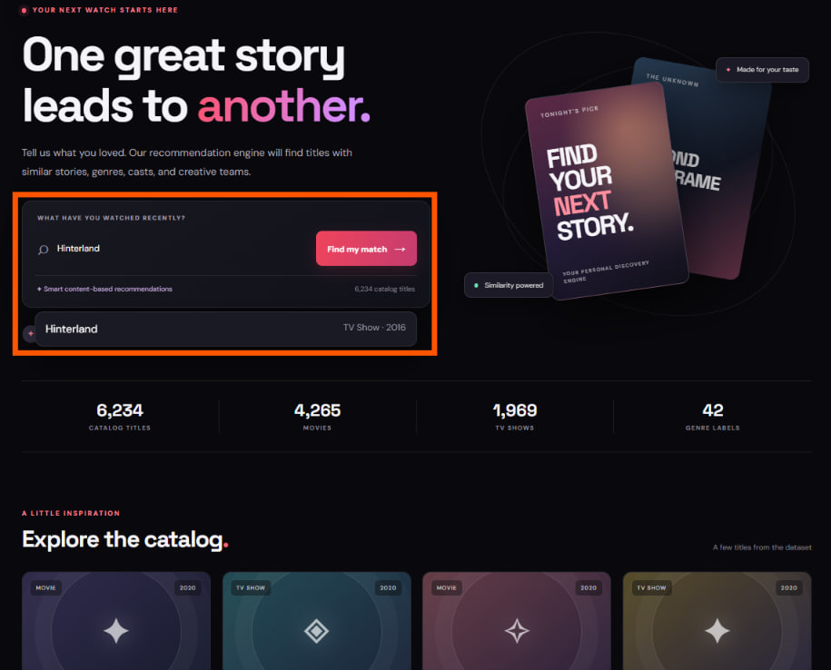
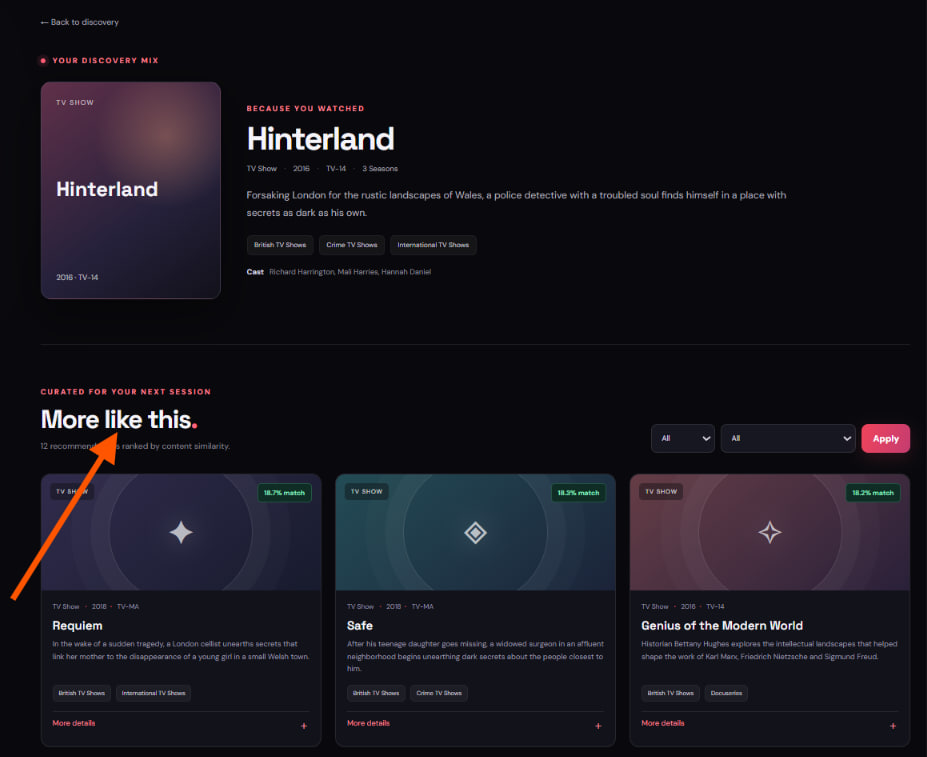
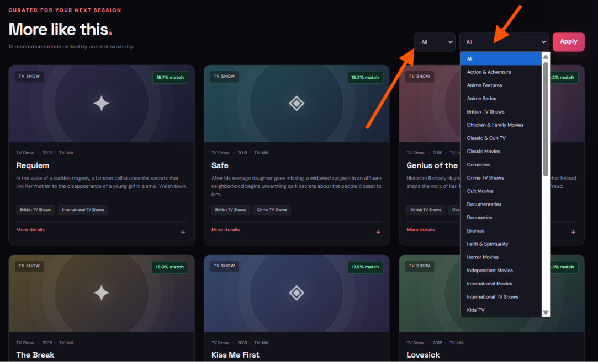

# CineMatch — Netflix Content Recommender

A Flask web application that recommends Netflix catalog titles using content-based machine learning. It represents each title through its genres, synopsis, cast, directors, and country, then ranks other titles with TF-IDF vectors and cosine similarity.

## Features

- Modern responsive dark interface
- Content-based recommendations with TF-IDF and cosine similarity
- Title search suggestions while typing
- Exact title matching with friendly not-found suggestions
- Filter recommendations by Movie / TV Show and genre
- Recommendation similarity scores
- Metadata cards for release year, rating, duration, genres, cast, director, and synopsis
- JSON endpoints for search and recommendations
- Clean separation between Flask routes and recommendation logic

## Screenshots

These screenshots are stored in the repository so they appear on GitHub:

### Search and discovery



### Recommendations



### Recommendation filters



## Project structure

```text
CineMatch/
├── app.py
├── recommender.py
├── requirements.txt
├── .env.example
├── .gitignore
├── README.md
├── data/
│   └── netflix_titles.csv
├── templates/
│   ├── base.html
│   ├── index.html
│   ├── results.html
│   └── 404.html
└── static/
│   ├── css/style.css
│   ├── js/app.js
│   └── screenshoot/
│       ├── 1,Search.jpg
│       ├── 2.Result.jpg
│       └── 3.Filter.jpg
```

## Run locally

Python 3.10+ is recommended.

```bash
# 1. Create and activate a virtual environment
python -m venv .venv

# Windows PowerShell
.venv\Scripts\Activate.ps1

# macOS / Linux
source .venv/bin/activate

# 2. Install dependencies
pip install -r requirements.txt

# 3. Start the application
python app.py
```

Open **http://127.0.0.1:5000** in your browser.

## How the recommender works

1. Load and clean the Netflix titles CSV dataset.
2. Combine descriptive metadata (director, cast, genres, description, and country) into one text field for each title.
3. Convert text into weighted numerical features with `TfidfVectorizer` (unigrams and bigrams; English stop words removed).
4. Compute cosine similarity between the selected title and the catalog.
5. Rank candidates by similarity and apply the selected type and genre filters.

The displayed similarity percentage is a relative text-similarity score, **not** a probability that a user will enjoy a title. The dataset does not contain user ratings or viewing histories, so this version is content-based rather than collaborative or hybrid filtering.

## Dataset note

The included CSV is a catalog snapshot and may not represent the current Netflix library. Posters, streaming availability, and live catalog updates are not included in the dataset. No fabricated poster images or availability claims are shown.

## API

- `GET /api/search?q=dark` — title suggestions
- `GET /api/recommendations/<title>` — selected title and ranked recommendations

 
